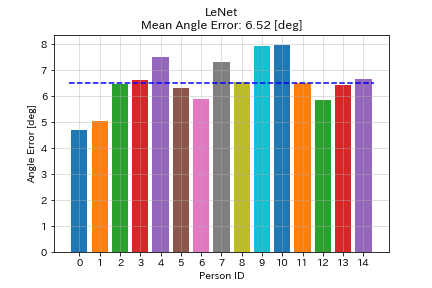
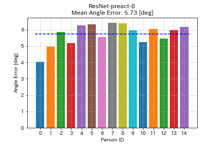
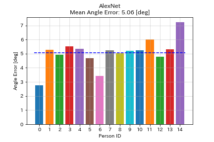
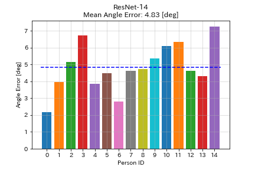

# An unofficial PyTorch implementation of MPIIGaze and MPIIFaceGaze

[](https://opensource.org/licenses/MIT)
[](https://github.com/hysts/pytorch_mpiigaze)

Training and evaluation code for the gaze estimation methods from the MPIIGaze and MPIIFaceGaze papers.
If you just want to run gaze estimation on a webcam without training anything, use [pytorch_mpiigaze_demo](https://github.com/hysts/pytorch_mpiigaze_demo) instead.
See also [pl_gaze_estimation](https://github.com/hysts/pl_gaze_estimation), a newer training codebase built on PyTorch Lightning.

## Requirements

* Linux (tested on Ubuntu only)
* Python >= 3.10
* [uv](https://docs.astral.sh/uv/)

Create the environment with:

```bash
uv sync
```


## Download and preprocess the datasets

### MPIIGaze

```bash
bash scripts/download_mpiigaze_dataset.sh
uv run python tools/preprocess_mpiigaze.py --dataset datasets/MPIIGaze -o datasets/
```

### MPIIFaceGaze

```bash
bash scripts/download_mpiifacegaze_dataset.sh
uv run python tools/preprocess_mpiifacegaze.py --dataset datasets/MPIIFaceGaze_normalized -o datasets/
```


## Usage

This repository uses [OmegaConf](https://omegaconf.readthedocs.io/) for
configuration management.
The default parameters and their types are defined in
[`gaze_estimation/config/config_schema.py`](gaze_estimation/config/config_schema.py),
which is not meant to be edited directly.
Override them with a YAML file like
[`configs/mpiigaze/lenet_train.yaml`](configs/mpiigaze/lenet_train.yaml),
or with `key=value` arguments on the command line, e.g. `train.test_id=1`.


### Training and evaluation

The following commands train a model on the data of everyone except
person `p00`, then evaluate it on `p00`:

```bash
uv run python train.py --config configs/mpiigaze/lenet_train.yaml
uv run python evaluate.py --config configs/mpiigaze/lenet_eval.yaml
```

[`scripts/run_all_mpiigaze_lenet.sh`](scripts/run_all_mpiigaze_lenet.sh) and
[`scripts/run_all_mpiigaze_resnet_preact.sh`](scripts/run_all_mpiigaze_resnet_preact.sh)
run this leave-one-person-out loop over all 15 people for LeNet and
ResNet-preact-8 with the default parameters.


## Results

### MPIIGaze

| Model           | Mean Test Angle Error [degree] | Training Time |
|:----------------|:------------------------------:|--------------:|
| LeNet           |              6.52              |  3.5 s/epoch  |
| ResNet-preact-8 |              5.73              |   7 s/epoch   |

Training times were measured on a GTX 1080 Ti.





### MPIIFaceGaze

| Model     | Mean Test Angle Error [degree] | Training Time |
|:----------|:------------------------------:|--------------:|
| AlexNet   |              5.06              |  135 s/epoch  |
| ResNet-14 |              4.83              |   62 s/epoch  |

Training times were measured on a GTX 1080 Ti.






## Demo

This repository no longer ships its own demo program. Use [ptgaze](https://github.com/hysts/pytorch_mpiigaze_demo) instead, which runs gaze estimation on webcam video or video files:

```bash
pip install ptgaze
ptgaze --mode mpiigaze
```

To visualize a model trained with this repository, convert the checkpoint to safetensors with `ptgaze-convert` and point `gaze_estimator.checkpoint` in a ptgaze config file at the converted file:

```bash
ptgaze-convert checkpoint_0040.pth model.safetensors --mode mpiigaze
```

See the [ptgaze README](https://github.com/hysts/pytorch_mpiigaze_demo) for details.

## Related repos

- https://github.com/hysts/pl_gaze_estimation
- https://github.com/hysts/pytorch_mpiigaze_demo

## References

* Zhang, Xucong, Yusuke Sugano, Mario Fritz, and Andreas Bulling. "Appearance-based Gaze Estimation in the Wild." Proc. of the IEEE Conference on Computer Vision and Pattern Recognition (CVPR), 2015. [arXiv:1504.02863](https://arxiv.org/abs/1504.02863), [Project Page](https://www.mpi-inf.mpg.de/departments/computer-vision-and-multimodal-computing/research/gaze-based-human-computer-interaction/appearance-based-gaze-estimation-in-the-wild/)
* Zhang, Xucong, Yusuke Sugano, Mario Fritz, and Andreas Bulling. "It's Written All Over Your Face: Full-Face Appearance-Based Gaze Estimation." Proc. of the IEEE Conference on Computer Vision and Pattern Recognition Workshops(CVPRW), 2017. [arXiv:1611.08860](https://arxiv.org/abs/1611.08860), [Project Page](https://www.mpi-inf.mpg.de/departments/computer-vision-and-machine-learning/research/gaze-based-human-computer-interaction/its-written-all-over-your-face-full-face-appearance-based-gaze-estimation/)
* Zhang, Xucong, Yusuke Sugano, Mario Fritz, and Andreas Bulling. "MPIIGaze: Real-World Dataset and Deep Appearance-Based Gaze Estimation." IEEE transactions on pattern analysis and machine intelligence 41 (2017). [arXiv:1711.09017](https://arxiv.org/abs/1711.09017)
* Zhang, Xucong, Yusuke Sugano, and Andreas Bulling. "Evaluation of Appearance-Based Methods and Implications for Gaze-Based Applications." Proc. ACM SIGCHI Conference on Human Factors in Computing Systems (CHI), 2019. [arXiv](https://arxiv.org/abs/1901.10906), [code](https://git.hcics.simtech.uni-stuttgart.de/public-projects/opengaze)
